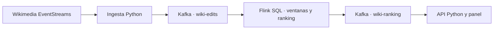
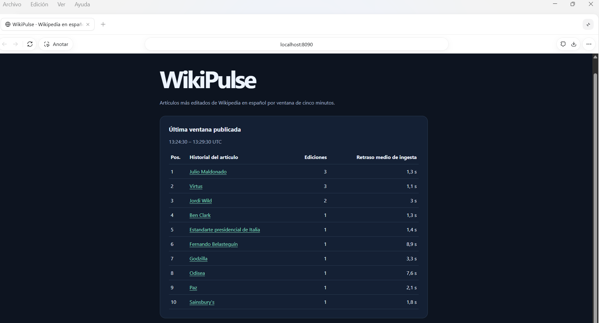

# WikiPulse

WikiPulse muestra los diez artículos más editados de Wikipedia en español en ventanas de cinco minutos. Cada fila enlaza al historial del artículo. La fuente es el flujo público [Wikimedia EventStreams](https://wikitech.wikimedia.org/wiki/EventStreams).





## En directo

Desde esta carpeta, con Docker y Compose v2:

```powershell
docker compose up --build -d
```

Abre el [panel](http://localhost:8090) y la [consola de Flink](http://localhost:8091). El ranking aparece al cerrar la primera ventana con datos. El cierre depende de que lleguen nuevos eventos y avance el watermark. La demo solo ingiere creaciones y ediciones de artículos de `eswiki` e incluye las de bots. Conserva el ID de cambio, título, marca de bot y marcas de tiempo, sin guardar nombres de usuario, comentarios ni contenido de las ediciones.

Puedes configurar `WIKIMEDIA_USER_AGENT` en `.env` con un contacto identificable. Python guarda el cursor SSE después de que Kafka confirma la escritura y lo usa para reconectar.

## Reproducción de datos reales

La muestra [data/ediciones-wikimedia.ndjson](data/ediciones-wikimedia.ndjson) contiene ediciones públicas capturadas el 11 de noviembre de 2026. Es una secuencia corta para comprobar el flujo.

Arranca un entorno limpio, con solo el procesamiento y el panel. Si vienes de una sesión anterior, `docker compose down -v` elimina sus volúmenes y checkpoints.

```powershell
docker compose up --build -d dashboard submit
docker compose run --rm --volume "${PWD}:/capture:ro" ingest python ingest.py replay /capture/data/ediciones-wikimedia.ndjson --speed 10
```

El replay acelera la espera entre registros y conserva sus tiempos originales. Flink necesita eventos posteriores para cerrar las ventanas. Usa una captura que cubra varios minutos y considera el tramo final como margen para el watermark. Para repetir la misma prueba reinicia con un entorno limpio.

Si quieres observar ventanas con cinco minutos completos de actividad, captura un tramo más largo con Python 3.10 o posterior y sustituye la ruta del replay por `/capture/edits.jsonl`.

```powershell
python -u ingest.py capture --count 300 | Set-Content -Encoding utf8 edits.jsonl
```

## Qué demuestra cada herramienta

| Herramienta | Papel |
| --- | --- |
| Python | Lee SSE, valida y filtra la entrada, reanuda con `Last-Event-ID` y sirve el panel. |
| Kafka | Separa la ingesta del procesamiento. Las ediciones de un título usan la misma clave. La salida se materializa por fin de ventana y posición. |
| Flink | Agrupa por título en ventanas deslizantes de cinco minutos, con un paso de 30 segundos y 10 segundos de margen en el watermark. Cuenta IDs distintos y resuelve empates por título. Los cambios de título se tratan como claves distintas. |
| Checkpoints | Flink guarda su estado y posición de lectura cada 10 segundos. El volumen compartido permite recuperar el TaskManager mientras el JobManager sigue activo. |
| Azure Event Hubs | Recibe la ingesta por su endpoint Kafka. Un puente confirma el offset de Azure después de publicar en Kafka local. |

El panel muestra el retraso medio entre la marca temporal de Wikimedia y la recepción por Python, calculado sobre los mensajes recibidos. El conteo usa IDs distintos, por lo que un reenvío del mismo cambio no incrementa el ranking. El watermark limita el desorden admitido y un evento puede llegar después de que alguna de sus ventanas ya haya cerrado. El checkpoint protege el estado interno de Flink. El sink realiza escrituras por clave con la garantía predeterminada del conector.

## Prueba de recuperación

En la sesión con datos reales del 11 de noviembre de 2026, Flink restauró el checkpoint 138 después de reiniciar el TaskManager. El panel avanzó de la ventana con cierre a las 13:45:30 UTC a la de las 13:46:00 UTC.

En un entorno limpio, arranca la demo sin la ingesta en directo y ejecuta:

```powershell
docker compose up --build -d dashboard submit
python smoke.py
```

La prueba de integración usa eventos controlados para verificar el ranking y su deduplicación. Espera un checkpoint posterior a la primera ventana, reinicia el TaskManager, comprueba el ID restaurado por REST y envía dos cambios más. La nueva ventana debe incluir los conteos de los cambios anteriores al reinicio. GitHub Actions ejecuta esta prueba al subir el proyecto como repositorio.

Si el panel no muestra filas, revisa `docker compose logs ingest submit taskmanager dashboard`. En Flink verifica que el job esté en ejecución, revisa el watermark del operador y compara los registros entrantes con los salientes. En **Checkpoints**, consulta el último snapshot completado y el restaurado.

## Ingesta opcional con Azure Event Hubs

Crea un Event Hub dedicado y una política SAS con permisos de envío y escucha. Copia `.env.example` a `.env` y configura `AZURE_BOOTSTRAP` como `<namespace>.servicebus.windows.net:9093`, `AZURE_CONNECTION_STRING` con la cadena SAS y `AZURE_TOPIC` con el nombre del hub. `.env` queda excluido de Git y del contexto de build. [Endpoint Kafka de Azure Event Hubs](https://learn.microsoft.com/azure/event-hubs/azure-event-hubs-kafka-overview).

```powershell
docker compose -f compose.yaml -f compose.azure.yaml up --build -d
```

Python envía los cambios a Azure con SASL/PLAIN sobre TLS. El puente los recibe y publica en `wiki-edits` del Kafka local, donde los lee Flink. Usa los mismos archivos de Compose al detener el entorno.

## Publicación

[Borrador para LinkedIn](LINKEDIN.md)
